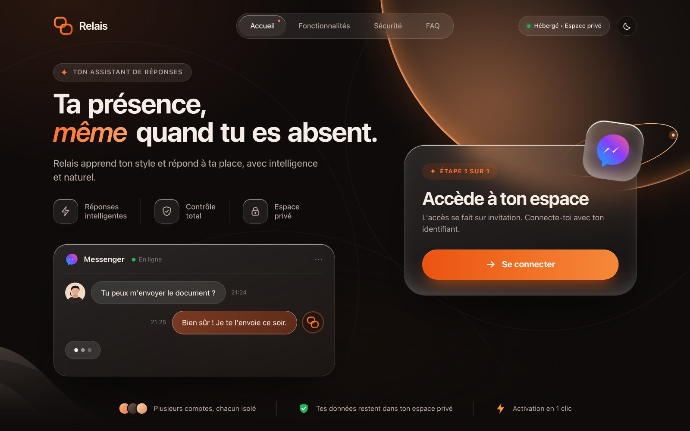
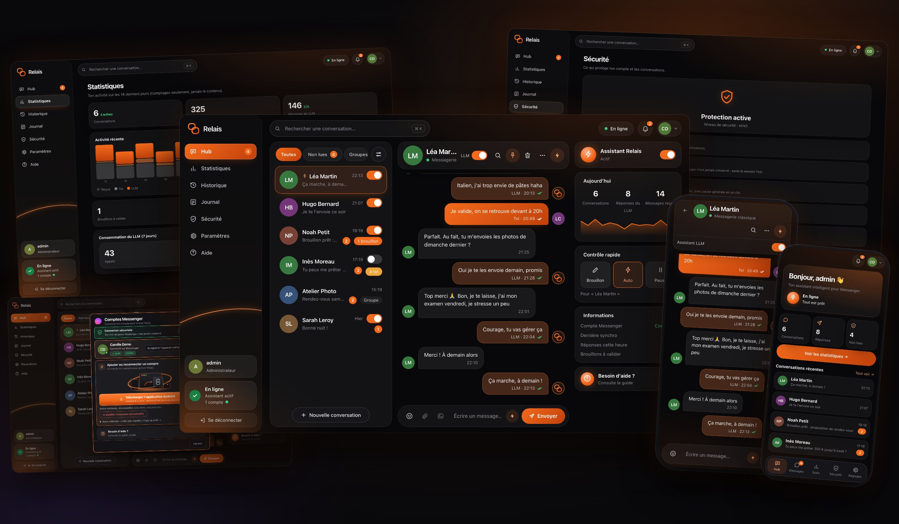
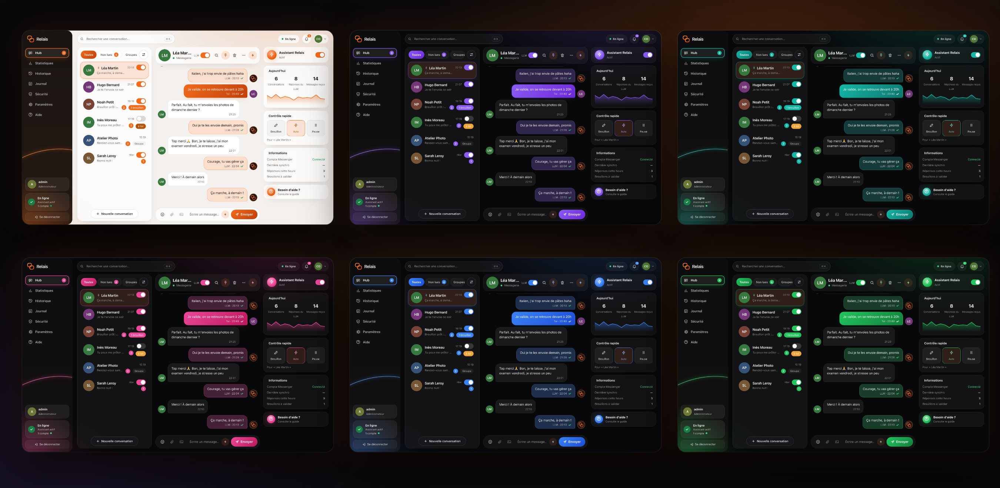
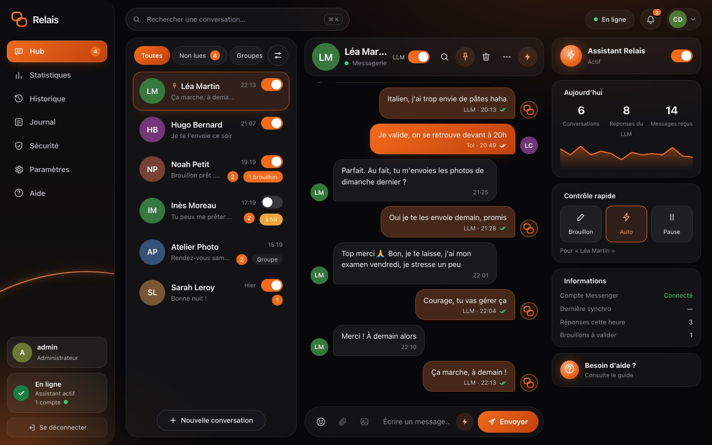
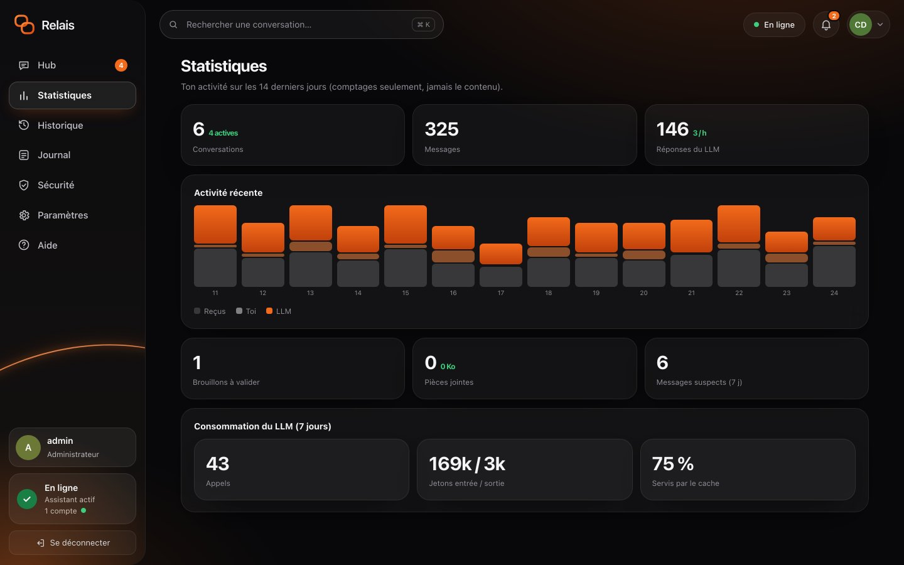
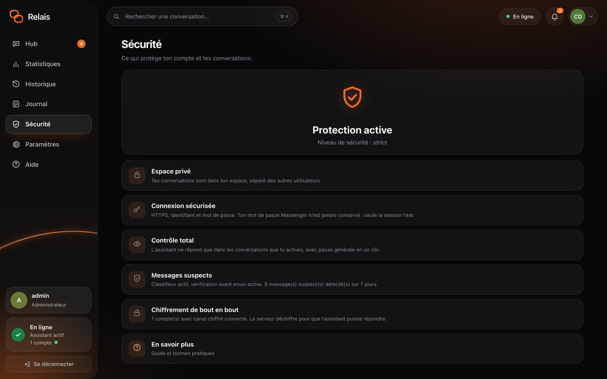
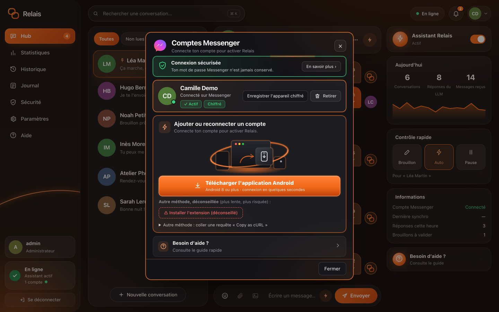
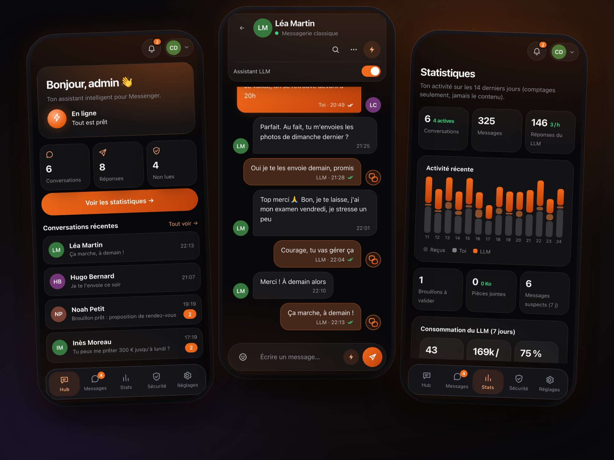
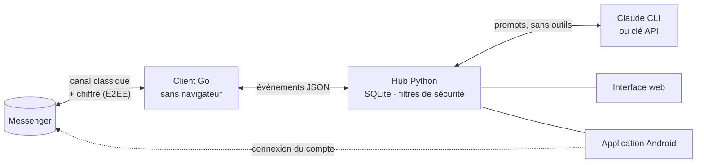

<div align="center">



<br>

# Relais

**Réponses automatiques par LLM sur Messenger, dans ton propre style.**<br>
Un client léger en Go (sans navigateur), un hub web multi-utilisateurs, une application Android et un déploiement Docker.

<br>


</div>

> [!WARNING]
> **Projet indépendant, non affilié à Meta.** Automatiser un compte Messenger personnel va à l'encontre des conditions d'utilisation de Meta et peut conduire à la suspension du compte. Utilise Relais uniquement sur **tes propres comptes**, en connaissance de cause. Si tu héberges les sessions d'autres personnes, tu es responsable de leurs données et de leur accord éclairé.

<br>

<div align="center">

<sub>Captures prises sur une instance de démonstration, avec des contacts et des conversations fictifs.</sub>
</div>

## Ce que fait Relais

Relais se connecte à ton compte Messenger, lit les messages entrants et, **dans les conversations que tu actives**, répond à ta place avec un LLM (Claude) en imitant ta façon d'écrire.

- 🗣️ **Réponses naturelles** : le style est appris à partir de tes vrais messages. Les réponses sont courtes, variées et sans formules d'assistant. Le hub évite les répétitions, les tics d'ouverture et les emojis en rafale.
- 🧠 **Mémoire par contact** : une fiche courte et lisible (relation, événements, engagements, préférences) avec un niveau de confiance par information. Tu peux la relire, la corriger ou la vider. Seules les lignes utiles au message du moment sont transmises au modèle.
- 🎛️ **Tu gardes la main** : mode *auto* ou *brouillon* par conversation, pause générale en un clic, limite de réponses par heure, le LLM se tait dès que tu écris toi-même.
- 🛡️ **Défenses contre les messages piégés** : détection des tentatives d'injection de consignes, vérification de chaque réponse avant envoi, leurre, journal des événements suspects.
- 🔐 **Sujets sensibles transmis à l'humain** : argent, engagements, conflits, décisions importantes. Une urgence (danger, détresse) déclenche une réponse d'empathie et une alerte pour toi.
- 👥 **Multi-utilisateurs** : chaque utilisateur a son identifiant, ses comptes Messenger, ses réglages et son style. Aucun ne voit les données des autres. Invitations par lien.
- 🔒 **Chiffrement de bout en bout** pris en charge côté client, y compris la restauration de l'historique chiffré par code PIN.
- 📎 **Pièces jointes** : images, GIF, vidéos, vocaux, fichiers, positions et aperçus de liens affichés dans le hub.
- 🎨 **Interface soignée** : thème sombre ou clair, 8 couleurs d'accent, version web et application Android.

<div align="center">

</div>

## Aperçu

<table>
<tr>
<td width="50%"><br><sub><b>Hub</b> — conversations, réponses du LLM en orange, contrôle rapide.</sub></td>
<td width="50%"><br><sub><b>Statistiques</b> — activité, consommation et cache du LLM (comptages seulement, jamais le contenu).</sub></td>
</tr>
<tr>
<td width="50%"><br><sub><b>Sécurité</b> — protections actives et messages suspects détectés.</sub></td>
<td width="50%"><br><sub><b>Comptes Messenger</b> — connexion depuis l'application Android.</sub></td>
</tr>
</table>

<div align="center">

</div>

## Comment ça marche



- Un **processus client Go par compte** Messenger (bibliothèque `messagix`) lit et envoie les messages, sans navigateur.
- Le **hub** (Python, bibliothèque standard + SQLite) stocke les conversations, applique les règles, construit les prompts et appelle le LLM. Le LLM n'a accès à aucun outil.
- L'**application Android** est une coque WebView : elle affiche le hub et sert à connecter ton compte Messenger depuis ton téléphone, avec ta propre session.

## Démarrage rapide (Docker)

Prérequis : un serveur Linux avec Docker, 2 Go de RAM conseillés. Le guide complet (pare-feu, HTTPS, sauvegardes, plusieurs utilisateurs) est dans [`deploy/README.md`](deploy/README.md).

```bash
git clone https://github.com/FabrichJean/messenger-llm-reply-assistant.git relais
cd relais

# 1. Configuration : mets un mot de passe administrateur d'au moins 12 caractères
cp deploy/.env.example .env && chmod 600 .env && nano .env     # HUB_PASSWORD=…

# 2. Le Dockerfile embarque l'application Android : fournis un APK (voir plus bas)
mkdir -p dist && cp /chemin/vers/relais.apk dist/relais.apk

# 3. Construction et démarrage
docker compose up -d --build
docker compose logs -f hub

# 4. Connecte Claude (ou renseigne ANTHROPIC_API_KEY dans .env)
docker compose exec -it hub claude
```

Le hub n'écoute que sur `127.0.0.1` du serveur : ouvre-le par un tunnel SSH (`ssh -L 8787:127.0.0.1:8787 utilisateur@serveur`, puis <http://localhost:8787>), ou derrière un reverse proxy HTTPS (Caddy est fourni, avec `DOMAIN` et `COMPOSE_PROFILES=https`).

## Développement local

```bash
go build -o messenger-lite .        # client Messenger (Go, CGO requis pour SQLite)
python3 hub/hub.py                  # hub sur http://127.0.0.1:8787
go test ./...                       # tests du client
tests/run.sh                        # tous les tests (client Go + hub de bout en bout)
```

Aucun compte n'existe au départ : tu les ajoutes depuis l'interface. Les secrets (cookies, clés chiffrées, base de données) vivent dans `accounts/` et dans le dossier de données du hub, tous deux exclus de git.

## Application Android

```bash
cd mobile
./gradlew assembleDebug                                         # essai rapide
./gradlew assembleRelease \
  -PhubUrl=https://ton-hub.exemple.fr \
  -PrelaisKeystore=/chemin/relais.jks -PrelaisKeystorePassword=…  # version signée
```

> [!IMPORTANT]
> Règle toujours `-PhubUrl` : sans lui, l'application pointe vers l'adresse de l'auteur du projet. Android 8 ou plus (`minSdk 26`).

La connexion Messenger se fait dans l'application, sur `messenger.com`. Le mot de passe n'est jamais lu ni conservé : seule la session l'est. Une extension de navigateur (**Relais Connect**, dossier [`extension/`](extension)) existe aussi, mais elle est plus lente et moins sûre : l'application reste la méthode recommandée.

## Sécurité

- Mots de passe hachés (scrypt), sessions liées à l'utilisateur, limitation des essais de connexion, protection CSRF et en-têtes de sécurité (CSP à empreintes de scripts, cookie `__Host-`).
- Isolation stricte des utilisateurs : propriété vérifiée sur chaque route de l'API. L'administrateur gère les comptes mais **ne lit pas** les conversations des autres.
- Conteneur durci : utilisateur non-root, système de fichiers en lecture seule, capacités retirées, port lié à `127.0.0.1`.
- Mots de passe Messenger jamais conservés ; l'appel au LLM se fait avec un environnement minimal et sans outils.

> [!NOTE]
> Un audit de sécurité indépendant n'a pas encore été réalisé. Si tu découvres une faille, ouvre une *issue* sans y publier de détails exploitables.

## Structure du dépôt

```
.
├── main.go, e2ee.go, history.go, attachments.go   Client Messenger (Go)
├── hub/
│   ├── hub.py                    Lanceur du hub (quelques lignes)
│   ├── relais/                   Code du hub, en couches
│   │   ├── config.py db.py context.py tls.py        Configuration, base SQLite, contexte de la requête
│   │   ├── auth.py security.py media.py             Utilisateurs et sessions, défenses, types de médias
│   │   ├── accounts.py login.py                     Comptes Messenger, connexion (extension, cookies)
│   │   ├── events.py attachments.py previews.py     Événements entrants, pièces jointes, aperçus de liens
│   │   ├── sync.py tasks.py                         Synchronisation de l'historique, tâches de fond
│   │   ├── llm/                                     Prompts, réponses, mémoire, style, humanisation, garde-fous
│   │   └── web/                                     Serveur HTTP, routes de l'API, utilisateurs
│   ├── users_cli.py adopt_account.py                Outils en ligne de commande
│   └── index.html login.html join.html              Interface web
├── mobile/                                          Application Android (WebView)
├── extension/                                       Extension « Relais Connect »
├── deploy/                                          Guide VPS, Caddy, sauvegardes, envoi de comptes
├── tests/                                           Tests (voir tests/README.md) : `tests/run.sh`
├── Dockerfile, docker-compose.yml                   Déploiement
└── MULTIUSER.md                                     Conception multi-utilisateurs
```

`main` regroupe tout ; les branches `feature/*` isolent chaque thème (`go-client`, `hub-core`, `hub-auth`, `hub-llm`, `android-app`, `extension`, `deploy`) et `chore/repo-meta` porte la configuration du dépôt.

## Licence

Distribué sous licence **GNU AGPL-3.0** : voir [`LICENSE`](LICENSE). Le client Go s'appuie sur [`mautrix-meta`](https://github.com/mautrix/meta) (`messagix`), lui aussi sous AGPL-3.0. Si tu proposes Relais comme service en ligne, la licence t'oblige à fournir le code source à tes utilisateurs.
